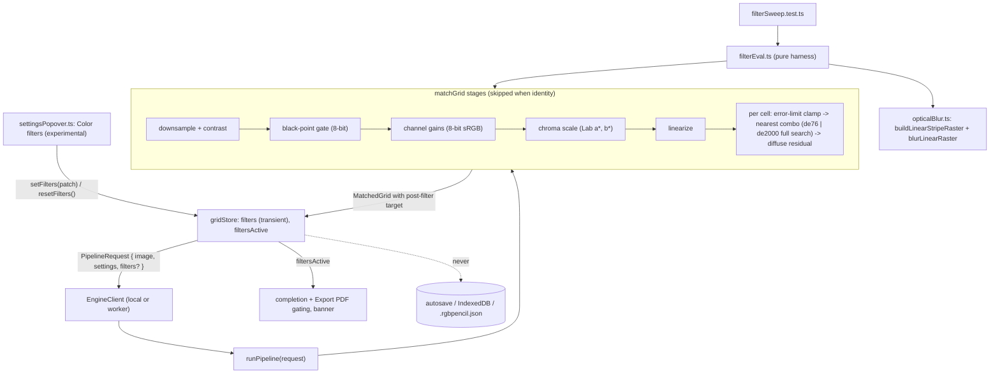

> [!NOTE]
> This document specifies **technical system architecture only** (data flow, storage, APIs, concurrency, state synchronization, and security).
> All visual, aesthetic, and UI design decisions (colors, typography, component styling, responsive layout) must be defined in `design.md`.

## Context

The matcher (`src/engine/matcher.ts`) picks, for every cell, the nearest of 125 stripe combinations by CIELAB ΔE76 and diffuses the residual with Floyd-Steinberg in linear RGB. Measurements (`research.md`) show neutrals match well (CIEDE2000 3 to 4.5) but warm saturated colours are far out of gamut (bright orange 21 to 31), and the diffusion has no bound on accumulated error, so unreachable colours push later cells to saturated red/green stripes. This change adds optional pipeline filters to test candidate fixes against a fixed score, without changing any default.

Constraints carried over: 100% client-side; the engine stays pure and DOM-free; the worker protocol and `PIPELINE_VERSION` must not change behaviour for defaults; project persistence and the `.rgbpencil.json` format are untouched; the paper drawing must never drift from the on-screen grid.

## System Architecture Diagram

## Goals / Non-Goals

**Goals:**
- Make each candidate correction independently switchable and exactly reversible (identity gives byte-identical output).
- Evaluate candidates reproducibly on fixed fixtures with fixed metrics before any default changes.
- Keep experiments from corrupting a real drawing: session-only, preview-only, locked while cells are done.

**Non-Goals:**
- Persisting filters or changing defaults (follow-up change, bumps `PIPELINE_VERSION`).
- Calibrated pencil palettes, per-image presets, a general photo editor.
- Approximating CIEDE2000 (shortlist and CIE94 rejected on evidence).
- Optimising the full CIEDE2000 search beyond straightforward precomputation.

## Technical Decisions

### 1. `filters` rides beside `settings` in the request, not inside it
- **Decision**: `PipelineRequest { image, settings, filters? }`. `ColorFilters`, `DEFAULT_FILTERS`, and an `isDefaultFilters` helper live in `src/types/pipeline.ts`. `PipelineSettings` and `StoredSettings` are unchanged.
- **Rationale**: `recordFromState` and the project file only see `settings`, so filters cannot leak into persistence by accident, and no schema, import-validation, or `PIPELINE_VERSION` work is needed for an experiment.
- **Alternatives**: Extending `PipelineSettings` (rejected, would persist and need validation and lock rules); a global mutable engine config (rejected, breaks purity and worker parity).

### 2. Fixed stage order with identity skipping
- **Decision**: downsample, contrast, black-point gate (8-bit), channel gains (8-bit sRGB), chroma scale (Lab), linearize, then matching. Each stage runs only when its filter is not at identity; when all are at identity the code path is the existing one.
- **Rationale**: The 8-bit stages mirror the assessment's wording ("channel < 25 -> 0", "R × 1.15") so presets are a faithful test of it; chroma scale needs a perceptual space; skipping identity stages is what guarantees byte-identical defaults without a parallel code path to maintain.
- **Alternatives**: Applying gains in linear light (rejected here, would not reproduce the assessment's recipe; can be a later candidate); a single combined colour matrix (rejected, the stages are not all linear).

### 3. Chroma scale through a Lab round trip
- **Decision**: Add `labToLinearRgb` (inverse of the existing `linearRgbToLab`, D65, same matrices) to `colorMath.ts`; scale `a*, b*` only; clamp to `[0,1]`; re-encode.
- **Rationale**: Scaling Lab chroma keeps lightness fixed, which separates the effect from the gains and contrast stages.
- **Alternatives**: HSV saturation (rejected, not perceptual); `culori` conversions per pixel (rejected, allocation churn; `culori` stays LUT-only).

### 4. Bounded diffusion error as a deviation clamp
- **Decision**: Keep a copy `orig` of the post-filter linear target. At each cell, `used = clamp01(clamp(adjusted, orig - L, orig + L))` per channel; match on `used`; compute the residual from `used`; spread as today. `errorLimit = null` or `L >= 1` is exactly the current behaviour. `matchGrid` accepts an optional `hooks.onCell(index, used, original)` for tests only.
- **Rationale**: One parameter with a directly testable bound; it stops unreachable residuals from accumulating without touching the kernel or the strength slider.
- **Alternatives**: Clamping the residual magnitude (rejected, bounds one step but not the accumulated sum); scaling diffusion by a reachability test (rejected, extra heuristic threshold); skipping diffusion when ΔE is high (rejected, discontinuous).

### 5. Exact full-search CIEDE2000, no shortlist
- **Decision**: `metric: 'de2000'` evaluates all 125 combos per cell with `deltaE2000` from `colorMath.ts` and picks the minimum. The `Float32Array` Lab table is reused; per-cell target quantities are computed once. `MatchedGrid.deltaE` keeps reporting ΔE76 between the matched value and the chosen combo.
- **Rationale**: Measured agreement with the exact answer is only 82.7% to 89.5% for ΔE76 top-K shortlists (K = 8 to 24) and 52% to 62% for CIE94, and the disagreements are exactly the out-of-gamut colours under study. Cost is acceptable for an experiment: about 165 ms at 56×42 and 485 ms at 96×72 in Node.
- **Alternatives**: Shortlist (rejected), CIE94 (rejected), lower-bound pruning to speed up the exact search (deferred; an optimisation, not needed to learn whether the metric helps).

### 6. Filters are transient store state with preview-only gating
- **Decision**: The store holds `filters` (default `DEFAULT_FILTERS`), derives `filtersActive`, and exposes `setFilters(patch)` and `resetFilters()`. `setFilters` refuses (`{ ok: false, reason: 'locked' }`) while `completedCells.size > 0`. Filters reset to defaults on every code path that replaces the source image or the open project (image load, sample load, project open or switch, import, start-new-drawing, delete-fallback). While `filtersActive`, the store ignores `toggleCell`/`paintCell`, the UI disables completion paths, and `Export PDF` is disabled. Filters never enter `recordFromState`, autosave, or export, and do not call `autosave.schedule()`.
- **Rationale**: The geometry-lock reasoning applies: marked cells must always correspond to the stripes on the paper. Making experiments preview-only removes any path where filtered stripes could be drawn, saved, or exported as if they were the project's real grid. Enforcement lives in the store, not only the UI.
- **Alternatives**: Persist filters with the project (rejected for now, needs schema, validation, and confirmation rules); allow completion under filters (rejected, silently desynchronises paper and screen after reload).

### 7. Pure evaluation harness reusing the Squint renderer
- **Decision**: `src/engine/evaluation/filterEval.ts` exports `evaluate(image, settings, filters)` and `sweep(fixtures, configs)`; it renders through `buildLinearStripeRaster` and `blurLinearRaster` at 1.0 cells so the score matches what the user sees in Squint view. Fixtures are decoded in tests only (`jpeg-js`, dev dependency) and area-averaged with the engine's own `downsampleAreaAverage`. The sweep test prints a markdown table and asserts structure and determinism, never improvement.
- **Rationale**: One renderer means the harness and the UI cannot disagree; not asserting improvement keeps the harness an instrument rather than a self-fulfilling test, and the hypotheses H1 to H5 are decided from the printed numbers.
- **Alternatives**: Browser screenshot diffs (rejected, slow and not deterministic); asserting expected winners (rejected, would bake the hypothesis into the test).

### 8. Worker protocol is additive
- **Decision**: `filters` is passed through `engineClient`, `pipelineClient`, and the worker adapter unchanged; `runPipeline` forwards it to `matchGrid`. Latest-job-wins already covers rapid filter edits; the existing `Updating…` caption covers the longer `de2000` runs.
- **Rationale**: No new message types, and structured clone handles the plain object.

## Risks / Trade-offs

- [CIEDE2000 runs take 165 to 485 ms] → They are in the worker, stale runs are coalesced, and the `Updating…` caption shows; the metric is opt-in and experimental. Record timings in `verification.md`.
- [The assessment's presets may look better by eye yet score worse] → The score is a guide, not a verdict: the decision record requires both numbers and the user's visual judgement, and nothing becomes a default in this change.
- [Two photos are a small sample] → Synthetic neutral and warm fixtures are included, and the report states the limits; more fixtures can be added without code changes.
- [Experimental state leaking into a real drawing] → Session-only state, store-enforced completion/export blocks, lock while cells are done, reset on every project or image change.
- [Float differences across platforms in the 8-bit stages] → Rounding is explicit (`Math.round`) and clamping is applied after each stage; tests assert exact integers for the documented cases.
- [Identity guarantee silently broken by refactoring `matchGrid`] → A byte-identical regression test on every fixture and the synthetic set, run in the normal suite.

## Migration & Rollback Plan

- Additive: new optional argument and request field, new UI section, new tests and fixtures. No data migration, no persisted-format change, no `PIPELINE_VERSION` bump.
- Branch from `origin/master` (PR #2 merged). Rollback: revert the commit(s); the app returns to the current behaviour with no residue.

## Open Questions

- If a candidate wins, should it become a default (bumping `PIPELINE_VERSION` so existing projects show the notice) or stay an optional persisted setting? Decide from the decision record.
- Should error-limited dithering also be exposed per-region (for example only in out-of-gamut cells)? Deferred until H1 is decided.
