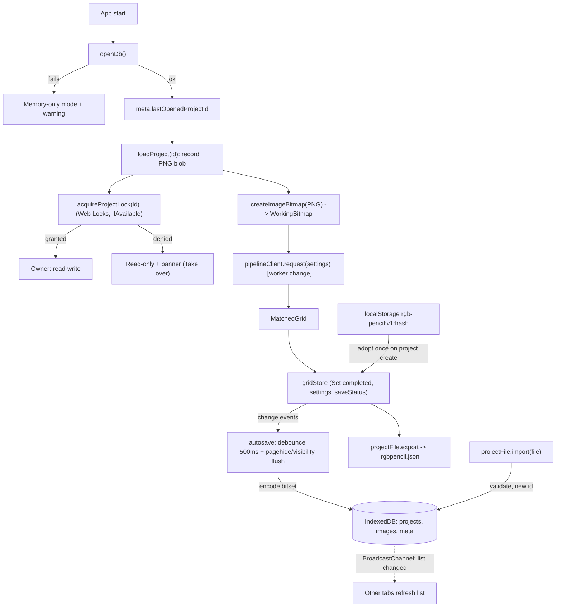

> [!NOTE]
> This document specifies **technical system architecture only** (data flow, storage, APIs, concurrency, state synchronization, and security).
> All visual, aesthetic, and UI design decisions (colors, typography, component styling, responsive layout) must be defined in `design.md`.

## Context

The first change persists only completed cells in localStorage, keyed by `sourceHash`. That loses the image and settings on close and cannot hold several drawings. `worker-pipeline-and-pdf-export` introduces a bounded `WorkingBitmap` (`<= 512` px) and a `sourceHash` independent of contrast, dither, and palette; those make storing a whole project cheap and safe. This change builds the storage layer, resume flow, project list, backup file, and tab-safety on top of them.

Constraints: 100% client-side; storage must survive reloads; the paper drawing must always correspond to the on-screen grid; a user may have the app open in several tabs; storage may be missing (private modes), full, or cleared.

## System Architecture Diagram

## Goals / Non-Goals

**Goals:**
- Reload, tab close, and browser restart return the user to the exact same image, settings, and completed cells.
- Autosave is cheap and bounded; a burst of drag-painting produces one write.
- Several drawings coexist; two tabs can never silently overwrite each other.
- A portable, validated backup file is the cross-device and anti-eviction route.
- All failure modes (no storage, quota, newer schema, bad file) degrade to a clear message, never to data loss or a crash.

**Non-Goals:**
- No cloud sync, accounts, or server backups.
- No undo history beyond re-click undo.
- No automatic cross-tab merging.
- No storage of the original uploaded photo.
- No encryption of stored data (it is the user's own local drawing).

## Technical Decisions

### 1. IndexedDB with three object stores and a thin local promise helper
- **Decision**: Database `rgb-pencil`, version 1. Stores: `projects` (key `id`, index on `updatedAt` and `sourceHash`), `images` (key `projectId`, value `{ projectId, width, height, png: Blob, thumb: Blob }`), `meta` (key `k`, e.g. `lastOpenedProjectId`). A local `projectDb.ts` wraps open/get/put/delete/getAll in promises; no `idb` dependency.
- **Rationale**: Blobs and ~0.5 MB records exceed what localStorage can hold across many projects. Keeping images in their own store means the project list reads only small records.
- **Alternatives**: localStorage (rejected, quota and synchronous); `idb` (deferred, `research.md`); one combined store (rejected, list loads every blob).

### 2. Lossless PNG for the working bitmap
- **Decision**: Encode with `canvas.toBlob('image/png')` (or `OffscreenCanvas.convertToBlob` where available) on save; decode with `createImageBitmap`. Draw to a canvas and read `getImageData` to rebuild the `WorkingBitmap`.
- **Rationale**: Bit-exact restore keeps `sourceHash` and matched states stable. JPEG was rejected in `research.md`.
- **Risk note**: canvas colour-management and premultiplied alpha can alter RGBA for translucent pixels. The working bitmap is opaque (composited onto white at load), so RGB is preserved; a test asserts the round trip.
- **Alternatives**: Store raw RGBA (~0.79 MB per project, rejected, ~2 to 3× larger than PNG for photos).

### 3. Project id is a UUID; `sourceHash` is only for matching
- **Decision**: `crypto.randomUUID()` at creation. `sourceHash` is indexed for same-image detection and legacy migration only.
- **Rationale**: Two drawings of one image (different settings) must coexist; hashing cannot be the identity.
- **Alternatives**: Key by `sourceHash` (rejected, collisions by design).

### 4. Completed cells as a bitset at the storage boundary
- **Decision**: `completedCodec.encode(set, cols, rows) → Uint8Array` and `decode(bits, cols, rows) → Set<string>`. Bit index `row * cols + col`. Out-of-range bits ignored on decode.
- **Rationale**: 294 to 864 bytes per project; trivial to base64 in the file; keeps the store's `Set<string>` API unchanged for the UI.
- **Alternatives**: Store `Set` as an array of strings (rejected, ~7 bytes per cell, larger and slower to diff).

### 5. Autosave scheduler
- **Decision**: `autosave.ts` subscribes to store changes (completed, settings, name). It starts a `500` ms timer on each change; the timer firing runs one `saveProject`. `visibilitychange` to hidden and `pagehide` call `flush()` immediately. Saves are serialised through a promise chain so two writes never overlap; the latest state wins. It sets `saveStatus` to `saving | saved | error | memory-only`.
- **Rationale**: Bounds writes during drag-painting and bounds possible loss to 500 ms or one in-flight write.
- **Alternatives**: Save on every toggle (rejected, write storm during drag-paint); only on unload (rejected, unreliable on mobile).
- **Known limit**: A write started in `pagehide` is best-effort; documented, not hidden.

### 6. Ownership with Web Locks; read-only mode
- **Decision**: `projectLock.ts` calls `navigator.locks.request('rgb-pencil:project:' + id, { ifAvailable: true }, cb)`. `cb` returns a never-resolving promise held until the project closes (resolved via an `AbortController`-style release). `null` lock → read-only. `Take over` calls `request(name, { steal: true }, cb)`; the previous holder's callback promise rejects with `AbortError`, which switches it to read-only after a best-effort flush.
- **Rationale**: Locks release automatically when a tab closes or crashes, so no heartbeat or stale-owner logic.
- **Alternatives**: `BroadcastChannel` claim/heartbeat as primary (rejected, needs timeouts); `localStorage` mutex (rejected, racy).
- **Fallback (no Web Locks)**: each save does `get(id)` and compares `updatedAt` to the value this tab loaded in the same `readwrite` transaction; if newer, skip the write and show `Reload project`. The compare-and-put inside one transaction avoids a race between check and write.

### 7. Cross-tab list freshness via `BroadcastChannel`
- **Decision**: Channel `rgb-pencil-projects` posts `{ type: 'list-changed' }` and `{ type: 'deleted', id }` after create/rename/delete/import. Receivers refresh the list; a tab whose open project was deleted switches projects.
- **Rationale**: Cheap, no polling. The lock, not the channel, protects writes.
- **Alternatives**: `storage` events (rejected, localStorage only).

### 8. Geometry lock enforced in the store, not only the UI
- **Decision**: `setGridWidth` and `setPalette` actions throw/return a `locked` result when `doneCount > 0`; `setContrast`/`setDither` require a `confirmed: true` argument when `doneCount > 0`. The UI disables controls and shows the confirmation, but the store is the enforcement point.
- **Rationale**: Prevents any code path (future keyboard shortcut, import tweak) from desyncing the drawing from the paper.
- **Alternatives**: UI-only disabling (rejected, trivially bypassed by another caller).

### 9. Project file format and import validation
- **Decision**: `{ format: 'rgb-pencil-project', version: 1, name, createdAt, updatedAt, pipelineVersion, settings, cols, rows, sourceHash, completed: <base64 bitset>, bitmap: { width, height, png: <base64> } }`. Import: size check (`<= 8 MB`) before `file.text()`; `JSON.parse` in try/catch; hand-written structural validator checking every field's type and range (see spec); bitset length check; PNG decoded with `createImageBitmap` and dimension check (`<= 1024`); assign a new UUID; names de-duplicated. Nothing from the file is evaluated or inserted as HTML; names are rendered as text only.
- **Rationale**: Files are untrusted input. Validation before any write means a bad file cannot leave partial records.
- **Alternatives**: Zod/Ajv (rejected, dependency for ~12 checks); ZIP with separate PNG (rejected, needs a zip library; base64 overhead of ~33% on ~0.5 MB is acceptable).

### 10. Legacy migration is read-only adoption
- **Decision**: `legacyMigration.adopt(hash, cols, rows)` reads `rgb-pencil:v1:<hash>` inside try/catch, parses `"col,row"` strings, drops out-of-range entries, returns a `Set<string>`, then removes the key. Called exactly once, from project creation.
- **Rationale**: Honors progress users made under the first change without keeping two write paths.
- **Alternatives**: Keep writing localStorage in parallel (rejected, two sources of truth).

### 11. Pipeline version constant
- **Decision**: `PIPELINE_VERSION` integer in `src/engine/pipeline.ts` (owned by the worker change) stored per project; mismatch raises a notice only.
- **Rationale**: Cell geometry depends only on `cols`/`rows`, so progress stays valid; only displayed colours may drift.

## Risks / Trade-offs

- [Browser evicts site storage after inactivity or under pressure] → `navigator.storage.persist()`, the backup nudge, and file export; eviction behaviour is an unverified assumption in `research.md`.
- [Debounce window or `pagehide` write lost] → Loss bounded to about 500 ms of toggles; documented.
- [Quota exceeded] → Warning plus delete suggestion; in-memory state untouched; retry on next change.
- [Steal takes the lock mid-write] → Previous owner flushes best-effort before going read-only; new owner reloads the record on acquisition.
- [Corrupt or hostile import file] → Validate-then-write, size and dimension caps, text-only rendering of names, new id.
- [PNG round trip alters pixels via colour management] → Opaque-only bitmap and a bit-exact round-trip test.
- [Schema downgrade (older app opens newer data)] → Refuse to open, never modify or delete.
- [Legacy and new keys diverge] → Legacy is adopted once then deleted.
- [Matching algorithm changes later] → `pipelineVersion` notice, progress retained.

## Migration & Rollback Plan

- Apply after `worker-pipeline-and-pdf-export`. Step 1: codec, db helper, project record, resume. Step 2: autosave and status. Step 3: project list, lock, same-image detection. Step 4: geometry lock in the store. Step 5: export/import and backup nudge. Step 6: multi-tab lock and channel. Step 7: legacy adoption.
- Schema upgrades run in `onupgradeneeded` with ordered steps; version 1 is the initial schema.
- Rollback: disable IndexedDB reads/writes and revert to the first change's localStorage path. IndexedDB data is left intact, so re-enabling restores everything. Users keep their exported files regardless.

## Open Questions

- Should deleted projects be recoverable for a short time (soft delete)? Deferred; confirmation plus export covers it for now.
- Cap on number of projects: show `navigator.storage.estimate()` usage only, or enforce a hard cap (for example 20)? Default here is no hard cap, only a usage hint.
