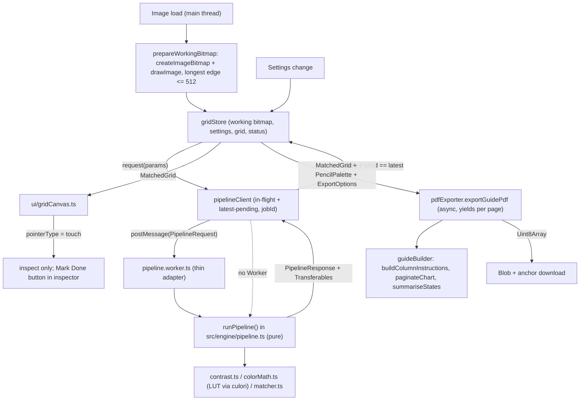

> [!NOTE]
> This document specifies **technical system architecture only** (data flow, storage, APIs, concurrency, state synchronization, and security).
> All visual, aesthetic, and UI design decisions (colors, typography, component styling, responsive layout) must be defined in `design.md`.

## Context

`design-language-and-ui-ux` (refactored from the prototype into vanilla TypeScript modules, no React) builds a synchronous engine behind an `EngineClient` interface (`contrast.ts`, `colorMath.ts`, `matcher.ts`), `gridStore`, and the canvas UI, and defers the Web Worker, PDF export, and RLE checklist. This change adds those three, plus the tap-to-inspect touch contract, on top of the engine and store contracts that change fixes. Persistence of the project across sessions is a separate change (`project-persistence`) that depends on the contracts here.

Constraints carried over: 100% client-side, no backend; default `56 × 42` grid, width range `16–96`; `96 × 72` is roughly 864k ΔE checks per run; hover and drag-paint must stay at 60fps while a run is in progress.

Known bound: grid height is not capped. A portrait image at width `96` can reach `128` or more rows, so anything sized by `rows` (RLE entries, chart tiles) must handle tall grids.

## System Architecture Diagram

## Goals / Non-Goals

**Goals:**
- One pure `runPipeline(request) → response` used identically by the worker, the synchronous fallback, and Node tests.
- Slider scrubbing never blocks hover or click; stale results never overwrite newer ones.
- `guideBuilder` and `pdfExporter` are DOM-free and unit-testable in Node.
- Shared contracts in `src/types/pipeline.ts` are plain data so `project-persistence` and Phase 2 calibration can reuse them unchanged.

**Non-Goals:**
- No Phase 2 calibration, no distance-blur view, no hover pop-up.
- No persistence of the image or settings (owned by `project-persistence`).
- No PDF progress carry-over (the exported guide is always a fresh, unchecked guide).
- No server-side anything; no custom PDF page sizes.

## Technical Decisions

### 1. Pure `runPipeline` plus a thin worker adapter
- **Decision**: Put the whole run (downsample, contrast, match, dither, hash) in `src/engine/pipeline.ts` as one pure function. `pipeline.worker.ts` only receives a message, calls it, and posts the result with a transfer list. `pipelineClient.ts` is a second implementation of the first change's `EngineClient` interface (the first change ships the local, synchronous one); `main.ts` swaps it in, so UI modules are untouched. The client falls back to calling `runPipeline` directly when `Worker` is missing or construction throws.
- **Rationale**: One code path to test, no behaviour drift between worker and fallback. The worker file stays well inside its `L1-L50` budget.
- **Alternatives**: Duplicated logic in the worker (rejected, drift); `comlink` RPC (rejected, one message type does not justify the dependency).

### 2. Protocol: `jobId`, in-flight plus latest-pending
- **Decision**: `PipelineRequest { jobId, bitmap, cols, contrast, dither, ditherStrength, palette }` and `PipelineResponse = { ok: true, jobId, grid, sourceHash } | { ok: false, jobId, error }`. The client holds `latestJobId`, one `inFlight`, and one `pending`. A new request while one is in flight overwrites `pending`; when the in-flight one finishes, `pending` is sent. Responses whose `jobId !== latestJobId` are dropped.
- **Rationale**: Workers cannot cancel a running synchronous loop. Coalescing bounds queue depth to 1, so a 30-event slider burst costs at most two runs rather than 30.
- **Alternatives**: Terminate and respawn the worker per request (rejected, cold-start cost and LUT rebuild every event); debounce only (rejected, still wastes a run per pause and gives no ordering guarantee).

### 3. Bounded working bitmap
- **Decision**: On image load the main thread draws the source to a canvas whose longest edge is at most `512` px (aspect preserved) and keeps that RGBA buffer as the `WorkingBitmap`. Each run clones it into the worker (~1 MB at `512 × 384`).
- **Rationale**: A `4032 × 3024` photo is ~48 MB; re-sending or re-averaging it per slider tick is wasteful. At `96` columns a `512` px edge still gives 5+ source pixels per cell, so area-average quality is unaffected.
- **Alternatives**: Transfer the original `ImageBitmap` once and downsample in the worker (rejected, `OffscreenCanvas`/`ImageBitmap` support varies and the main thread needs the bitmap for persistence anyway).

### 4. Results returned as transferred typed arrays
- **Decision**: `MatchedGrid` uses flat typed arrays (`ri`, `gi`, `bi`: `Uint8Array`; `deltaE`: `Float32Array`; `target`: `Uint8ClampedArray` of length `3N`). Buffers are listed in the transfer list.
- **Rationale**: Zero-copy, cheap hover lookups (`ri[r*cols+c]`), trivially `structuredClone`-safe.
- **Alternatives**: Array of `MatchedCell` objects (kept only as a derived view type; rejected as storage, ~7k objects per run).

### 5. `sourceHash` ignores contrast, dither, and palette
- **Decision**: FNV-1a over the pre-contrast area-averaged RGB bytes plus `cols` and `rows`, computed in `runPipeline`.
- **Rationale**: Changing contrast must not orphan completed cells. Width changes rightly change it. This is the single identity input that `project-persistence` uses for "same image" matching.
- **Alternatives**: Hash the post-contrast grid (rejected, progress lost on every contrast tweak).

### 6. `culori` builds and verifies the LUT, never runs in the hot loop
- **Decision**: `buildComboLUT` may use `culori` for the 125-entry sRGB→Lab conversion (once per palette). The matcher compares against a flat `Float32Array` of Lab triples.
- **Rationale**: Honours the plan's `culori` choice and the prior change's performance decision; tests cross-check our maths against `culori` within `0.5` per Lab component.
- **Alternatives**: `culori` per pixel (rejected, allocation churn); no `culori` at all (rejected, loses an independent oracle for tests).

### 7. Vector-drawn state symbols in the PDF
- **Decision**: Draw `□ ● ◐ ◑ ■` with pdf-lib rectangle, ellipse, and clipped-path operators; use only standard fonts for text.
- **Rationale**: Standard fonts are WinAnsi and cannot encode these glyphs; embedding a TTF adds a dependency plus a font licence. Vectors also print crisply at any scale.
- **Alternatives**: `@pdf-lib/fontkit` plus an embedded font (rejected); letters `W F L H S` (rejected, loses the shared symbol language with the inspector legend).

### 8. Page geometry and pagination
- **Decision**: Margin `36` pt. A4 `595.28 × 841.89` pt, US Letter `612 × 792` pt. Chart cell `24 × 24` pt (three `6` pt glyph slots), index gutter `18` pt, tile header `36` pt. `tileCols = floor((printW − 18) / 24)`, `tileRows = floor((printH − 36 − 18) / 24)`, then `paginateChart` with one-line overlap. Template cell width is `cellMm × 72 / 25.4` pt with the same tiling logic.
- **Checklist**: two columns per page, `10` pt run rows, `14` pt title, `6` pt padding. Entries are not split unless one alone exceeds a page, in which case it continues under `(cont.)`.
- **Rationale**: Fixed numbers make page counts predictable and testable; the oversize path covers portrait grids (`128+` rows → `1,300+` pt tall at `10` pt).
- **Alternatives**: Auto-shrink to fit one page (rejected, symbols become unreadable on dense grids).

### 9. Asynchronous export that yields
- **Decision**: `exportGuidePdf` is `async`; it `await`s a macrotask yield (`setTimeout(0)`) after each page. Downloads use `Blob` + object URL + hidden anchor, URL revoked after click.
- **Rationale**: pdf-lib runs on the main thread. For `168` stripe columns the checklist alone is a handful of pages, but template pages at `96 × 72` add more; yielding keeps the UI responsive without a second worker.
- **Alternatives**: Run export in the worker (rejected for now: pdf-lib in a worker works, but doubles the bundle path and the job protocol for no measured need; revisit if a measured export exceeds ~1 s).

### 10. Touch: inspect-only on `pointerType === 'touch'`
- **Decision**: The canvas `pointerdown`/`pointermove` handler branches on `pointerType`. Touch sets the inspected cell only and records `lastPointerType = 'touch'` in the store; the inspector reads that flag to render `Mark Done / Undo`. Canvas uses `touch-action: none`.
- **Rationale**: Prevents accidental completion while panning a finger across a dense grid; no double-tap ambiguity with browser zoom.
- **Alternatives**: Double-tap to toggle (rejected, zoom conflict and accidental marks); long-press (rejected, discoverability and timer complexity).

## Risks / Trade-offs

- [Worker run is slower than estimated on low-end phones] → Soft timing budget in tests, in-flight+pending coalescing caps work, and the previous grid stays visible while a run is pending.
- [Worker bundling differs between Vite dev and build] → Use the standard `new Worker(new URL('./pipeline.worker.ts', import.meta.url), { type: 'module' })` form and run `npm run build` in verification.
- [Stale result applied after an image swap] → The `jobId` counter is global per client, not per image; loading a new image bumps `latestJobId` before the first request.
- [PDF generation freezes the tab on huge grids] → Yield per page; disable the button while busy; revisit worker export if measured.
- [Template prints off-scale due to printer "fit to page"] → Print an explicit scale note and a `10 mm` calibration bar on each template page.
- [Prior-change touch behaviour conflicts] → This change replaces "touch `pointerdown` toggles" with inspect-only; flagged in `design.md` and `tasks.md`, and applied after the prior change lands.
- [Tall portrait grids exceed assumptions] → Oversize RLE entries continue with `(cont.)`; tile pagination is already height-agnostic.

## Migration & Rollback Plan

- Apply after `design-language-and-ui-ux`. Step 1: extract `runPipeline` from the synchronous call site with no behaviour change. Step 2: add worker and client behind the same store action. Step 3: add exporter and Export PDF button. Step 4: touch behaviour.
- Rollback: set the client to always use the synchronous fallback, hide Export PDF, restore touch `pointerdown` toggling. No persisted data changes in this change.

## Open Questions

- Should the exported PDF optionally mark already-completed cells (a "remaining work" guide)? Deferred; fresh guide only for now.
- Measure real `96 × 72` worker latency on a mid-range phone before settling the soft budget.
